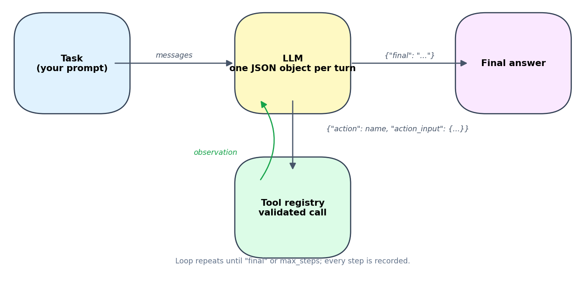

# Agentic AI Lab




A tiny, dependency-free toolkit for building tool-using AI agents in Python.
The whole core is three small modules you can read in one sitting, with a test
suite that runs offline against a scripted mock model.

## Why

Agent frameworks hide the interesting parts. This lab keeps them visible:

- **`agentlab.agent`** - a ReAct-style loop: the model replies with one JSON
  object per turn, either calling a tool or giving a final answer. Tool results
  go back in as observations until the task is done or `max_steps` is hit.
- **`agentlab.tools`** - a registry that validates arguments and turns tool
  errors into observations, so the model can recover from its own mistakes.
- **`agentlab.llm`** - a one-method protocol (`complete(system, messages)`),
  plus `MockLLM`, a scripted stand-in that makes agent behavior fully testable
  without API keys or network.

## Approval gate for sensitive tools

Tools that change the world (flag a claim, issue a refund) can be registered
with `sensitive=True`. A sensitive call only runs when the agent's `approver`
- a callable taking `(tool_name, arguments)` - allows that exact call:

```python
def reviewer(name, args):
    ...  # ask a human, or apply a policy rule; return True to allow

agent = Agent(llm, tools, approver=reviewer)
```

The gate **fails closed**: with no approver, or an approver that errors, the
call is denied and the model gets an observation telling it to move on.
Denied calls show up in `result.steps` with `blocked=True`, so every run is
auditable. The claims-triage example shows the pattern end to end.

## Retrieval as a tool

`agentlab.retrieval.KeywordRetriever` is a dependency-free retriever; wrap its
`search` in a tool and the agent can ground answers in documents. See
`examples/benefits_rag_agent.py` (synthetic plan FAQ, illustrative text only).

## Per-run call budgets

`@tools.register(..., max_calls=2)` caps how often a tool can run in one agent
run (counters reset at the start of each `Agent.run`). Over-budget calls return
an error observation instead of executing - a cheap safety net for refunds,
flags or paid API calls. Invalid calls do not spend budget.

## Loop guard

If the model issues the identical tool call `max_repeats` times in a row
(default 3), the run stops with `stopped_reason="loop_detected"` instead of
burning steps or repeating a side effect.

## Audit trail

`agentlab.trace` exports any run as JSONL - one line per step (thought,
action, arguments, observation, blocked flag) plus a summary line:

```python
from agentlab import trace
trace.write_jsonl(result, "traces/run.jsonl")
```

Regulated workflows (claims, refunds) get a durable record of what the
agent did and what the approver allowed or denied.

## Quickstart

```bash
python examples/calculator_agent.py   # watch a scripted agent solve 6 * 7 + 0
python examples/claims_triage_agent.py  # synthetic claims triage + approval gate
python examples/expense_audit_agent.py  # synthetic expense auditing (finance)
python examples/benefits_rag_agent.py  # retrieval-as-a-tool, synthetic benefits FAQ
python -m pytest                      # run the offline test suite
```

## Using a real model

Write one adapter:

```python
class OpenAILLM:
    def complete(self, system, messages):
        ...  # call your model, return its text

agent = Agent(OpenAILLM(), tools)
```

Nothing else changes - the loop, validation and error handling are
model-agnostic.

## Roadmap

- Planner-executor pattern on top of the same loop
- Retry/backoff and structured-output helpers in the real-model adapter
